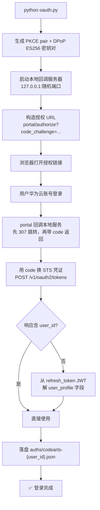
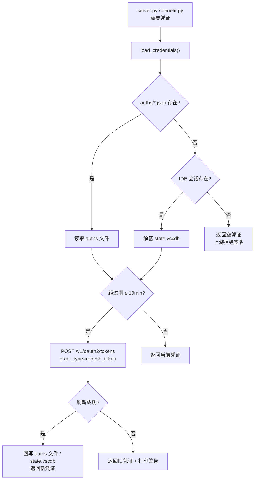

# CodeArts OpenAI 兼容代理

把华为云 CodeArts 的模型接口（盘古开源大模型、GLM、DeepSeek 等）包装成**标准 OpenAI Chat Completions API**。

底层走华为云 `SDK-HMAC-SHA256` 请求签名，凭证通过 OAuth2 PKCE 登录获取（与 CodeArts IDE 同源），无需手动配置 AK/SK。

> [!TIP]
> 建议使用 opencode、pi、hermes、openclaw 作为智能体接入。免费 CodeArts 具有 5 并发限制，其他代码智能体通常会超过这个限制，从而影响体验。

---

## 快速开始

### 1. 安装依赖

```cmd
pip install -r requirements.txt
```

### 2. 登录获取凭证

```cmd
python oauth.py
```

自动打开浏览器，用华为云账号登录后自动换取 STS 临时凭证，保存到 `auths/codearts-{user_id}.json`。凭证有效期约 2 小时，到期前自动用 refresh_token 续期（28 天有效），无需重复登录。

服务器模式（无浏览器环境）：

```cmd
python oauth.py --print-only
```

打印授权链接，手动在浏览器打开完成登录后，将回调 URL 粘贴回终端。

### 3. 启动代理

```cmd
python server.py
```

默认监听 `http://127.0.0.1:8787`。

### 4. 在各类工具中接入

把 OpenAI 兼容 Base URL 指向 `http://127.0.0.1:8787/v1`：

- API Key：任意非空字符串（例如 `codearts`）
- 模型：`openpangu-2.0-pro`、`glm-5.3-flash`、`deepseek-v4-flash-0731` 等

兼容工具：OpenCode、Cline、Continue、LobeChat、Cherry Studio、AtomCode 等所有支持自定义 OpenAI 兼容端点的工具。

---

## 凭证体系

项目支持两种凭证来源，`credential_provider.py` 按优先级自动选择：

| 优先级 | 来源 | 说明 |
|---|---|---|
| 1 | `auths/*.json` | `oauth.py` 生成的 OAuth 凭证，脱离 IDE 独立运行 |
| 2 | IDE 会话 | 读取 CodeArts IDE 的 `state.vscdb`（加密存储），适合 IDE 已登录的场景 |

### OAuth 登录流程（`oauth.py`）



关键技术点：

- **PKCE**：code_verifier（64 随机字节 base64url）+ code_challenge（S256）
- **DPoP**：ES256/P-256 密钥对，JWT 签名绑定 htm+htu，低 S 归一化，签名格式 `base64url(r || s)`
- **DPoP 私钥与 refresh_token 绑定**：续期必须复用同一密钥对，换密钥即失效
- **refresh_token 一次性消耗**：每次续期返回新的 refresh_token，形成轮换链

### 凭证加载与续期（`credential_provider.py`）



`auths/*.json` 和 IDE 会话都支持自动续期。refresh_token 一次性消耗，每次续期返回新的 refresh_token 形成轮换链。

---

## 免费额度与每日签到

CodeArts 有两套福利体系：

| 福利 | 额度 | 适用模型 | 领取方式 |
|---|---|---|---|
| 每日 1000 万福利 Token | 当日有效，24:00 清零 | 福利模型（deepseek-v4.1-flash、glm-5.3-flash、deepseek-v4-flash-0731、deepseek-v4-pro-0813） | 客户端登录 / server 启动自动领取 |
| 每日 1000 积分 | 发放后 30 天有效，活动至 2026-12-31 | 积分通道模型（GLM-5.2、glm-5.2-sft-harmony 等 agent 通道模型） | 本项目 `benefit.py credit` 纯 API 领取（snap-access 网关，AK/SK 签名） |

积分不领取会耗尽，agent 通道模型报 HTTP 402 `insufficient_quota`（TM.00001050）即此原因。

### 手动操作

```cmd
python benefit.py            # 全部：Token 签到 + 积分签到 + 各项余额
python benefit.py status     # 只查询 Token 签到状态
python benefit.py claim      # 只领每日 1000 万福利 Token
python benefit.py credit     # 只领每日 1000 积分 + 查积分余额
python benefit.py models     # 查询免费模型列表
```

### 自动领取

`server.py` 启动时自动执行以下操作（由 `CODEARTS_BENEFIT_AUTO_CLAIM` 环境变量控制，默认开启）：

1. **模型同步时自动领取**：每次拉取模型列表前调 `benefit.claim()`（幂等，重复领取报 4006 不影响）
2. **每日自动签到**：后台 daemon 线程，每天检查签到状态，未签则自动领取

> 积分（每日 1000）不在 server 自动领取范围内，需 `python benefit.py credit` 领取；
> 可配 Windows 计划任务每日执行 `python benefit.py`（Token + 积分一起领），见 `benefit.py` 文件头注释。

关闭自动领取：

```ini
CODEARTS_BENEFIT_AUTO_CLAIM=0
```

### 免费模型

| 模型 | 上下文窗口 | 云端下发 max_tokens | 上游实际接受上限 | 通道 |
|---|---|---|---|---|
| `deepseek-v4-flash-0731` | 1,048,576 | 393,216 | ≤65,536（131,072 实测被拒） | Token |
| `glm-5.3-flash` | 1,048,576 | 131,072 | 65,536 | Token |
| `deepseek-v4-pro-0813` | 1,000,000 | 393,216 | ≤65,536（未逐模型二分） | Token |
| `deepseek-v4.1-flash` | 1,000,000 | 384,000 | ≤65,536（未逐模型二分） | Token |
| `GLM-5.2` | 202,752 | 131,072 | 65,536（66,560 起报 `InferHub.001001005.400`） | 积分 |
| `glm-5.2-sft-harmony` | 202,752 | 131,072 | 65,536 | 积分 |

> 云端下发的 `max_tokens` 是上下文口径的值，直接当输出上限发给 InferHub 会整请求被拒，
> 且拒绝以流内错误帧的形式返回（HTTP 仍是 200），Agent 类客户端会当成空响应反复重试。
> `server.py` 因此把入站 `max_tokens` 钳到 `CODEARTS_MAX_TOKENS_CAP`（默认 65,536），
> `/v1/models` 也按钳制后的值上报，避免客户端照着 131,072 设值。

---

## 接口说明

| 端点 | 说明 |
|---|---|
| `POST /v1/chat/completions` | OpenAI 格式聊天补全，支持 `stream` 流式、`tools` 工具调用 |
| `GET /v1/models` | 模型列表（含免费模型，标注 `supports_function_calling`） |

---

## 配置

| 环境变量 | 默认值 | 说明 |
|---|---|---|
| `CODEARTS_BENEFIT_AUTO_CLAIM` | `1` | 免费额度自动领取与每日签到开关 |
| `CODEARTS_MAX_TOKENS_CAP` | `65536` | 入站 `max_tokens` 钳制上限（上游 InferHub 实际接受的输出上限） |
| `CODEARTS_CONN_RETRY_MAX` | `2` | 拿到响应前的连接级失败（TLS 中断/连接重置）重发次数 |
| `CODEARTS_CONN_RETRY_BACKOFF` | `0.5` | 上述重发的退避基数（秒，第 n 次等 n×基数） |

---

## 代码结构

```text
CodeArts2api/
├── server.py               # 主服务：签名 + 转发 + 模型列表 + 福利自动领取
├── oauth.py                # OAuth2 PKCE 登录 → auths/*.json
├── credential_provider.py  # 凭证加载（auths 文件优先 → IDE 会话）+ 自动续期
├── benefit.py              # 福利签到/查询工具（Token + 积分双签到）
├── auths/                  # OAuth 凭证存储（gitignore，勿提交）
├── models-cache.json       # 模型列表缓存
├── requirements.txt        # Python 依赖
├── test_openai.py          # 本地测试脚本（需 server 在跑，会真实打上游）
├── test_upstream_offline.py # 离线单测：假上游，不联网、不写 request.log
└── README.md
```

---

## 本地测试

```cmd
python test_upstream_offline.py   # 离线单测：不打上游，可随时跑
python test_openai.py             # 端到端：需 server 已在 8787 运行，会真实消耗额度
```

离线单测用假 `_upstream` / 假 `_hmac_headers` 覆盖：连接级重发次数与重新签名、读超时不重发、
max_tokens 钳制、正常路径不受影响，以及 `_signed_request` 的规范串与独立实现逐字节一致。

---

## 说明

- **`max_tokens` 入站钳制**（2026-10-12）：上游 InferHub 实际只接受 `max_tokens ≤ 65536`
  （实测 65536 通过、66560 起整请求被拒），而云端下发的 `model_parameters.max_tokens`
  是上下文口径的 131072+。客户端照它设值时，上游不返回 4xx，而是在已建立的 SSE 流里
  塞 `InferHub.001001005.400` 错误帧，Agent 客户端按空响应无限重试。现改为转发前钳到
  `CODEARTS_MAX_TOKENS_CAP`，`/v1/models` 也按钳制后的值上报。

- **连接级失败有界重发**（2026-10-12）：上游网关会偶发 TLS 中断
  （`SSLEOFError: UNEXPECTED_EOF_WHILE_READING`）与连接重置，此前 `max_retries=0`
  直接把 502 抛给客户端。现在对「一个响应字节都没拿到」的失败重签后重发
  （默认 2 次）；读超时不重发，避免上游已在推理时重复计费。urllib3 在 TLS 报错时会
  丢弃该连接，所以重发一定走新连接。

- **流中错误帧显式暴露**（2026-10-11）：上游偶发在 2xx SSE 流里夹带错误帧
  （如 `InferHub.001001005.400 The request param is invalid`）。此前流式路径裸透传，
  Agent 客户端只看到空 delta → "no content and no tool calls" 无限重试。
  现已改为：识别 `error_code`/`error_msg` 帧 → 转 OpenAI `{"error": {...}}` 帧
  并终止流，客户端可直接看到真实原因。

- 代理只做签名和转发，不修改模型行为。
- 每次调用会消耗华为云 CodeArts 套餐额度（token）。
- 仅绑定 `127.0.0.1`，不会对外网开放。
- `auths/` 目录含敏感凭证（AK/SK/securityToken/refresh_token），已加入 `.gitignore`，请勿提交。
- 本项目及本项目作者与华为云平台及其附属公司无任何关系，且华为云平台中并未对本项目中调用方式明确提出允许，若造成封号/限流等任何因使用本工具造成的情况与项目作者无关。如果您使用该项目，则默认视为同意本 README 中所有说明。

# 社区

感谢 [LinuxDO](https://linux.do/) 对本项目进行推广
